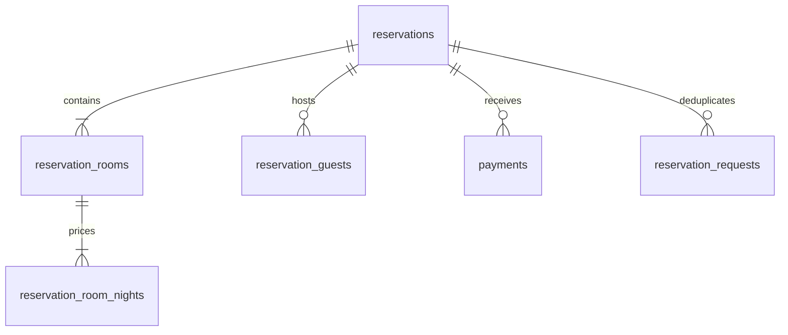

# Reservation workflow

A reservation owns one date range, one status, one contact, and one bill. Every
room in it arrives and leaves together. Use separate reservations when rooms
need different dates or lifecycle states.



- `reservations`: shared check-in/check-out dates, status, actual arrival and
  departure timestamps, cancellation reason, discount, and notes.
- `reservation_rooms`: room type, optional physical room assignment, and adult
  and child counts. There are no room dates or room statuses.
- `reservation_room_nights`: saved prices for each room and each booked night.
- `payments`: positive amounts, method, `payment_date`, optional reference and notes,
  and a separate creation timestamp. Discounts belong to the reservation.
  There are no financial kinds, waivers, voids, corrections, or history snapshots.

## Dates and status

Stay nights use UTC dates and the range `[checkIn, checkOut)`, up to 60 nights.
Changing dates changes the nights of every room. Retained nights keep their
saved prices; added nights use current rates. Changing a room type reprices that
room. Room assignments and occupancy counts remain editable.

| Reservation status | Reserves inventory | Room charges |
| --- | --- | --- |
| `confirmed` | Yes, over saved dates | Retained |
| `checked_in` | Yes, over saved dates | Retained |
| `checked_out` | Yes, over saved dates | Retained |
| `no_show` | No | Retained |
| `cancelled` | No | Removed from the bill |

Check-in requires every room to have a physical assignment. Check-in records one
arrival timestamp; checkout records one departure timestamp. Recording checkout
does not change the booked dates or require the balance to be paid. For an early
departure that should release nights and change charges, save the shorter date
range together with checkout.

Status corrections use the same status control. Confirming again clears actual
arrival and departure. Restoring a cancelled or no-show reservation checks
availability again. Cancellation keeps room rows and payments; payments can
therefore leave a credit. Removing a room deletes that line and its nights and
clears its staying-guest assignments. At least one room must remain.

## Saving

Creation accepts shared dates alongside `guest` and `rooms`. Changes use
`POST /reservations/:id/commands`; the same actions can be calculated without
writing through `POST /reservations/:id/preview`.

For example, shortening a reservation and checking out all its rooms is one save:

```json
{
  "requestId": "550e8400-e29b-41d4-a716-446655440000",
  "actions": [
    { "type": "dates", "checkIn": "2026-10-10", "checkOut": "2026-10-12" },
    { "type": "set-status", "status": "checked_out" }
  ]
}
```

Payment changes use `add-payment` with `payment`, `edit-payment` with
`paymentId` and `payment`, and `delete-payment` with `paymentId`. Payment input
requires `amountCents`, `method`, and `paymentDate` in `YYYY-MM-DD` format.
The date cannot be in the future. References and notes are optional. Edits
retain the payment ID and creation timestamp.

Room assignment changes use `edit-room`; adding and removing lines use
`add-room` and `remove-room`. There are no partial check-in, partial checkout,
room cancellation, move, or undo-arrival commands.

The write is one atomic D1 batch. It temporarily releases the reservation inside
the transaction, writes room changes, and validates the final reservation with
SQLite triggers. This permits swaps while preventing overbooking, duplicate
assignments, and closure conflicts. Any failure rolls back the whole save.

There is no reservation version field or expected-version guard. A request ID
only deduplicates retries: retrying the same request cannot record a payment
twice, and reusing the ID with different data is rejected.
